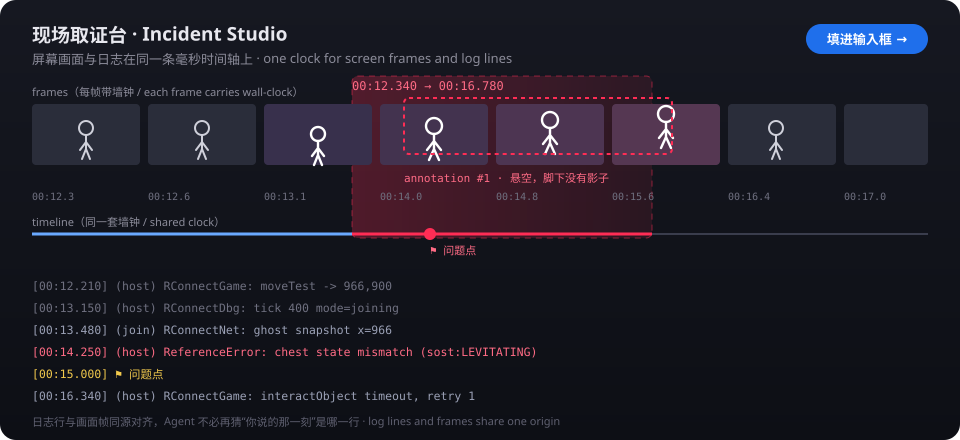

# Incident Studio · dsh-incident-studio

English | [中文](README.zh.md)

A right-sidebar plugin for [DeepSeek Harness](https://github.com/deepseek-ai/deepseek-harness) that **puts screen frames, log lines and keyboard/mouse input on one millisecond timeline**. Record, mark the seconds that went wrong, drag boxes on the frame, type one sentence — then hand the agent a keyframe strip, an animated GIF, the aligned log slice and your description, straight into the composer.

Nothing here is game- or project-specific: log sources are configured, any program that writes a file works, programs can push events directly, and the input recorder is told which process to watch.



## The problem it solves

A hands-on bug report ("I picked up the chest and the character floats") is obvious **on screen** and obscure **in the log**. You write a sentence, the agent has to guess which of the last 900 log lines was "that moment" — and which key you happened to press.

This plugin ties four things to one clock:

| Evidence | Where it comes from | Precision |
|---|---|---|
| Picture | Host-side frame capture (three paths, below) | 6 fps by default, every frame carries wall-clock time |
| Events | Log file tailing, markers, HTTP ingest | line-write time, tens of ms; ingest can be exact |
| Keys/mouse | Polling helper, only while a target owns the foreground | ~30 Hz, ±1 sample |
| Your words | boxes drawn on the frame + one sentence | attached to the selected range |

Every delivered log line is prefixed with `[00:12.340]` relative to the recording start — the same origin as the frames and the key events — so the agent never has to guess the moment, or what you pressed.

## Using it

```
Record ──> frames + log lines + keys/mouse, one clock
   │
Mark (⚑) when it breaks ──> Stop
   │
Review: drag the range, box the problem, one sentence, browse the input list
   │
Build artifacts ──> frames.png (6-frame strip) + clip.gif, saved in the workspace
   │
Fill composer ──> text + attachments in the input box (or Send now)
```

1. **Open the panel**: the `+` in the right sidebar (guide card "Incident Studio"), or the `🎥 Capture` button under the composer. On first mount it opens itself once and remembers that in `localStorage`.
2. **Configure log sources** (once): panel → Settings → absolute path (or workspace-relative). The file may appear later — start recording first, launch the game afterwards. On the same page set the **target process** (e.g. `Remains`) so the input recorder knows which window to watch.
3. **Record**: pick a capture source → `● Start recording`. Hit `⚑ Mark` when it breaks (as often as you like) — a mark automatically remembers the last key you pressed before it.
4. **Review**: the default range is the last mark ±3 s; drag the ends yourself or use `All` / `Last 8s` / `±3s around mark`. Moving the playhead moves the log list; clicking a line seeks the picture. The Input block expands into every key press / click in the range, and each one seeks too.
5. **Annotate**: drag a box on the frame; each box takes a note.
6. **Hand off**: `Build artifacts` → `Fill composer`. The strip is attached by default, the GIF is optional; press Enter yourself or use `Send now`.

### The ingest endpoint (for programs)

Any local process (a mod, a test script, a dev server) can push events instead of writing a file:

```sh
curl -X POST http://127.0.0.1:<dsh-port>/dsh-incident-studio/api/ingest \
  -H "content-type: application/json" \
  -H "x-incident-token: <token shown in the panel's Settings>" \
  -d '{"text":"entered the raiders room","src":"RConnect","level":"info"}'
```

The token is per host process and visible in the panel; the same-origin panel needs no token. Pass `wall` (epoch ms) to place an event at an exact time; otherwise arrival time is used.

## What you get on disk

Into **the current session workspace**, `.dsh-incidents/<recording-id>/`:

```
.dsh-incidents/20261104-193045-a1b2c3/
  frames-20261104193045.png   six-frame strip with timestamps and red boxes
  clip-20261104193045.gif     animated GIF of the range (460 px wide)
  input.jsonl                 raw key/mouse events, one JSON object per line
  bundle.md                   full note: description, boxes, every event line, input record
  bundle.json                 the same, machine-readable
```

An excerpt of `bundle.md`:

```markdown
# Character floats after picking up a chest

- **Captured at**: 2026-11-04 19:30:45 (+08:00)
- **Range**: `00:12.340` → `00:16.780` (00:04.440)
- **Capture path**: GDI screen grab 6fps
- **Input**: 12 key downs, 3 clicks, 1 foreground switch (26 events in range)

## What went wrong
Picked up the chest, the character levitates and never returns to the walk animation

## Event stream (in range)
```log
[00:12.210] (host) RConnectGame: moveTest -> 966,900
[00:14.250] (host) ReferenceError: chest state mismatch (sost:LEVITATING)
[00:15.000] ⚑ problem
```

## Input record
- Sampling: polling at ~50 Hz, state changes only, no text content at all
- Scope: while `remains` is in front; pointer recorded at click positions only
- 26 events in range: 12 key downs / 12 ups, 3 mouse clicks, 1 foreground switch
- Most pressed: W×8 (2.40s total), Space×2, LShift×2
- Longest hold: W 0.91s (`00:12.900`→`00:13.810`)

### Input around each mark
**`00:15.000` problem** (last input: Space ↓ 0.12s before)

```input
[00:14.420] W ↓
[00:14.880] Space ↓
[00:15.020] Space ↑ (0.14s)
```
```

What lands in the composer is the **compact** version: phenomenon, range, artifact paths, box notes, the key/mouse counts, and at most 80 log lines (errors and markers kept first, marks carry their "last input"); the full record is one path away.

## Three capture paths

| What the host process can reach | Path | Notes |
|---|---|---|
| `electron.desktopCapturer` (Electron main process) | timed JPEG grabs | 6 fps / 960 px / q62 by default; can pick a **window** |
| Node only (Electron utility process, plain `dsh web` host) | **Windows GDI grabber** (`tools/grab-frames.ps1`) | whole virtual desktop (all monitors), one long-lived PowerShell writing JPEGs; the host deletes each temp file as it ingests it |
| A real browser on `dsh web` | `getDisplayMedia` + `MediaRecorder` | needs screen-sharing permission; frames are extracted locally afterwards |

All three produce "frames with wall-clock time", so annotation, export and hand-off are identical.

> **Measured, not assumed**: the DSH desktop host cannot reach `desktopCapturer` (`/state` reports `nativeReason: "desktopCapturer 不可用"`), so the desktop app actually takes the GDI path. GDI uses `System.Drawing` + `Graphics.CopyFromScreen`: at 320 px / 4 fps a frame is ~5 KB, 1.4 s yields 5 frames with strictly increasing timestamps and the temp folder is gone after stop (`node test/live-capture.mjs`). The cost is that you cannot pick a single window.

Frame buffering is capped (900 frames / 96 MB / 5 minutes by default); the oldest frames are dropped, so a long recording cannot bloat the host.

## Keyboard and mouse input

"I pressed W and it froze", "clicking this button does nothing" — the agent cannot feel your hands. While recording, the plugin also records keys and clicks **on the same clock** as the frames and the log:

- **What**: every key down/up (name + virtual-key code), left/right/middle/X1/X2 button down/up with screen coordinates, foreground window switches (target / other / this plugin), and an optional pointer path.
- **How**: `tools/record-input.ps1` is a long-lived helper that reads `GetAsyncKeyState` every 20 ms (~30 Hz) and writes **changes only**. No keyboard hooks, no layout translation, no `ToUnicode` — deliberately: a low-level hook is what keyloggers install (antivirus bait) and it would put system input latency behind your process.
- **Only while a target owns the foreground**: set the target process in Settings (`Remains` or `Remains.exe`, comma separated). Alt-tab out and the recorder pauses with an explicit "focus lost" line, so typing elsewhere never lands in the record. The plugin host process is always excluded.
- **Hold durations**: key-up lines carry `(0.14s)`. Keys still held when focus leaves are *not* given a made-up release time; a single `blur-release: W, Space` line is written and those holds are left out of the statistics.
- **Mark anchors**: pressing `⚑ Mark` looks back 2 s for the last key/button down and writes it into the mark — `(last input: Space ↓ 0.12s before)`.
- **Caps**: 20 000 events per recording (oldest dropped and counted), 24 MB of raw JSONL, and the helper stops itself after 30 minutes.
- **Requirements**: Windows with the built-in Windows PowerShell 5.1. The first run compiles a small assembly (0.1–1 s, then cached under `%LOCALAPPDATA%\dsh-incident-studio\`).

Whether it works here is decided by a **real probe at start-up**; the result lands in `$DSH_HOME/storages/dsh-incident-studio/input-capability.json`, and Settings shows either `Input helper ready (108 keys)` or the concrete reason. When it is unavailable, only this one feature is off.

> **Measured**: `node test/live-input.mjs --inject` really presses left Shift (Shift alone types nothing) and asserts the helper saw the down and the up — a 155 ms hold became two events, within half a sample of truth. At 30 Hz the helper uses ~2.2% of one core and ~67–120 bytes per event.

## Configuration

The panel's Settings edits `<DSH_HOME>/storages/dsh-incident-studio/profiles.json` (`DSH_HOME` defaults to `~/.dsh`; on Windows `%USERPROFILE%\.dsh`). You can edit it directly:

```json
{
  "version": 1,
  "activeId": "my-project",
  "profiles": [
    {
      "id": "my-project",
      "name": "My project",
      "note": "main instance and test instance",
      "sources": [
        { "id": "main", "label": "main", "color": "#6aa9ff", "kind": "file",
          "path": "C:/Users/you/AppData/Roaming/MyApp/logs/main.log", "enabled": true, "preRoll": true },
        { "id": "test", "label": "test", "color": "#7bd88f", "kind": "file",
          "path": "C:/Users/you/AppData/Roaming/MyApp-test/logs/main.log", "enabled": true, "preRoll": true }
      ],
      "input": { "enabled": true, "targets": "Remains.exe", "scope": "target", "pollMs": 20, "trailHz": 0 }
    }
  ]
}
```

- `path` does **not** expand `%VAR%` or `$HOME`; use an absolute path or one relative to the workspace.
- `preRoll` (on by default) takes the last 96 KB / 800 lines when recording starts and marks them "before the recording"; those lines have no per-line timestamp, so they get ordinal placeholders (`-N` ms) to keep their order.
- `kind` is `file` today; `ingest` and `marker` events are generated by the plugin itself.
- `input`: key/mouse settings, stored per profile (one per game). `targets` are process names (`.exe` optional, case-insensitive, up to 8); `scope: "all"` records any foreground window except the plugin itself; `pollMs` is the sample interval (10–200, 20≈30 Hz, 10≈60 Hz); `trailHz > 0` also records the pointer path (much bigger file, off by default). `enabled: false` turns the feature off.

Optional host config, on the profile's patch row:

```yaml
- id: incident-studio
  config:
    artifactsDirName: .dsh-incidents   # artifact folder, relative to the session workspace
    captureFps: 6                      # frame rate
    captureWidth: 960                  # frame width
    captureQuality: 62                 # JPEG quality
    inputProbe: true                   # real input-helper probe at start-up (off saves one PowerShell run)
```

### A copy-paste example: Remains (Adobe AIR) mod logs

AIR games write mod logs under `File.applicationStorageDirectory`, i.e. `%APPDATA%\<app-id>\Local Store\`:

```
C:/Users/<you>/AppData/Roaming/pfe/Local Store/<ModName>.log     ← main instance
C:/Users/<you>/AppData/Roaming/pfe2/Local Store/<ModName>.log    ← second test instance
```

Put those two absolute paths in two log sources. These logs are **append-only**: only new lines are captured, `preRoll` brings the tail in as "before the recording", and since the lines carry no timestamps the alignment is "the moment this line hit the file".

## Install

Requires **DeepSeek Harness 0.2.1+** (it uses the 0.2.1 Connection service and sidebar tab API).

```sh
# straight from this repo — client.js is committed, there is no build step
dsh plugin --profile <profile> add https://github.com/Eclipse-NotFound/dsh-incident-studio

# once it is on npm
dsh plugin --profile <profile> add dsh-incident-studio
```

Desktop profiles are managed by the app: install from **Settings → Plugins** with the package spec, not by pointing the CLI at `profiles/web` (that will not show up in the desktop app). A new host half needs one app restart; the browser half is republished and re-applied on the page.

Disable it by removing `dsh-incident-studio` from `dsh.profile.bundles`, or with a profile patch:

```yaml
- id: incident-studio
  disabled: true
```

## Privacy and boundaries

- **Frames are captured only after you press Start recording, and stop when you stop.** The GDI path grabs the whole virtual desktop — move sensitive windows away first.
- **Key/mouse recording runs only during a recording and, by default, only while a target process is in front.** It records *which key went down/up and where the mouse clicked* — **no text at all** (no layout translation, no `ToUnicode`) — and installs no keyboard hooks. The plugin host process is always excluded, so typing into the panel or the chat is never recorded.
- Frames, GIFs, the raw key/mouse record and the note are written **only** into the session workspace's `.dsh-incidents/`; `profiles.json` and the three receipts (`client-boot.json`, `capture-capability.json`, `input-capability.json`) live in `$DSH_HOME/storages/dsh-incident-studio/`. The recorder's temporary JSONL lives in the system temp folder and is deleted right after being archived into the incident folder.
- **No network calls, no telemetry.** Data reaches a model only after you press Fill composer / Send — through DSH's normal message path, exactly like typing it yourself.
- Every `/dsh-incident-studio/api/*` route goes through the host's same-origin check; other local processes can only push events with the per-process `x-incident-token`. `/open` may only open paths inside this session's `.dsh-incidents/`.
- The self-check receipts record counts and stages only (`client-boot.json`: how far the page got; `capture-capability.json`: how many screens/windows exist; `input-capability.json`: key-table size and timing). No window titles, no pixels, no keystrokes.

## Develop

```sh
npm ci                        # dev deps: type references plus jsdom / react-dom / gifenc for tests
node tools/build-client.mjs   # concatenate src/client/*.js into client.js, with a syntax check
node test/run.mjs             # 457 assertions: host routes, input recording, manifest/release shape, client pure functions, seat registration, jsdom click-through, GIF/strip, capture polling
node test/live-capture.mjs    # real GDI capture (grabs ~1.4 s of screen at 320px, deletes it immediately; keep it out of CI)
node test/live-input.mjs      # real input helper (--inject presses left Shift to prove capture works; keep it out of CI)
node tools/check-live.mjs --fetch   # check a running DSH: routes, module graph, served bundle, capture/input capability, page receipts
```

`client.js` is a **generated artifact** — do not edit it by hand. `src/vendor/gifenc.js` is generated from `node_modules/gifenc` by `tools/vendor-gifenc.mjs` (MIT).

```
index.js                             host half: log tailing, frame capture, input recorder wiring, 18 routes, artifacts
src/client/00-head.js … 90-tail.js   browser half, concatenated into client.js in order
tools/grab-frames.ps1                Windows GDI screen grabber
tools/record-input.ps1               key/mouse polling helper (compiles and loads the assembly below)
tools/input-interop.cs               interop source (GetAsyncKeyState / foreground process / precise clock + key table)
tools/check-live.mjs                 live self-check (routes / module graph / served bundle / receipts)
test/host.test.mjs                   real HTTP server exercising every route
test/input.test.mjs                  input recording: config, line parsing, statistics, anchors, markdown, fake helper end to end
test/manifest.test.mjs              package manifest / release shape (no BOM, dsh.bundle, files whitelist)
test/pure.test.mjs                   loads the shipped client.js and tests the pure helpers
test/client-apply.test.mjs           runs apply() against a fake client context, then the hand-off chain
test/capture.test.mjs                capture polling, stop, failure reporting, API error mapping
test/dom.test.mjs                    clicks through the whole panel inside jsdom
test/live-capture.mjs                real-machine GDI capture
test/live-input.mjs                  real-machine input helper (probe / self test / real run / optional injection)
```

`check-live.mjs` answers "is it actually loaded": `403` means a route is registered and rejecting external callers by design (`404` means it is not registered); the module graph must contain this plugin and the served `client.js` must be byte-identical to your build (plus one source-map trailer); `client-boot.json` must show `apply → seat → panel`.

## Known limitations

- **Publishing timing**: the host half is assembled at boot (editing `index.js` needs a DSH restart); the browser bundle follows live updates and re-runs `apply` when the host republishes. Measured: a **real content change** to the profile's `cordis.patch.yml` triggers a host recompose, editing files inside the plugin folder does not.
- **Alignment precision**: tailing sees a line once it is written, so expect tens of milliseconds; use `/ingest` with `wall` when it must be exact.
- **The desktop path is a frame sequence, not a video**: 6 fps reads gradient/interpolation glitches fine, single-frame animation curves less so. Raising `captureFps` to 10–15 costs memory and JPEG work.
- **GDI grabs the whole desktop**: no per-window capture, all monitors merged.
- **GIF uses one 128-colour palette** (fixed from the first frame): small files and a clean picture for screen content; large gradients may band slightly.
- **Browser webm extraction relies on seeking**: `MediaRecorder` output has no index, so a trailing frame can be lost in extreme cases.
- **No voice**: descriptions are typed and boxed.
- **Input is recorded only while a target owns the foreground** — that is a safety default, not a defect. Use `scope: "all"` to widen it, at the cost of recording other windows' keys too.
- **No mouse wheel**: `GetAsyncKeyState` cannot see wheel deltas; that would need a mouse hook or Raw Input, which this plugin deliberately avoids. Mark and describe wheel actions instead.
- **Input timing is ±1 sample**: 20 ms (~30 Hz) by default, `pollMs: 10` for ~60 Hz (slightly more CPU).
- **The helper needs to compile C#**: antivirus/EDR may block runtime compilation and loading of the small assembly (hit exactly that on the development machine: `Add-Type`'s temp file was refused). That is why the plugin runs a real probe at start-up, writes `input-capability.json`, and shows the reason in Settings; when blocked, only input recording is unavailable.
- **Artifacts live in the workspace**: add `.dsh-incidents/` to your `.gitignore` (that includes `input.jsonl`).

## License

MIT. The product instinct is inspired by [AGIHunt/blurt](https://github.com/AGIHunt/blurt) (a macOS menu-bar "talk to your agent" tool); this is a general-purpose incident panel inside DSH, with a different implementation and setting.
