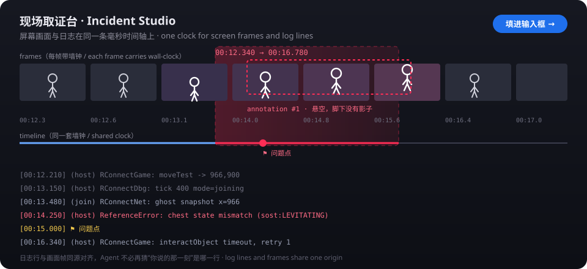

# 现场取证台 · dsh-incident-studio

[English](README.md) | 中文

一个 [DeepSeek Harness](https://github.com/deepseek-ai/deepseek-harness) 侧边栏插件：**把屏幕画面和日志放在同一条毫秒时间轴上**。录完圈出问题那几秒、在画面上拖红框标注、写一句现象，然后把「关键帧条带 + 动图 + 对齐后的日志切片 + 你的描述」一键填进 composer 交给 Agent。

它不绑定任何游戏或项目：日志源是配置出来的，任何会写文件的程序都能接；程序也可以反过来把事件直接推给插件。



## 它解决什么

实测类问题（游戏模组、GUI 客户端、前端交互）在**画面上**很明显，在**日志里**很隐晦。人写一句话反馈给 Agent，Agent 得自己翻几百行日志去猜「你说的那一刻」是哪一行。

这个工具把三件事绑在一起：

| 证据 | 来源 | 精度 |
|---|---|---|
| 画面 | 宿主抓帧（见下文三条路） | 默认 6 fps，每帧带墙钟时间 |
| 事件 | 日志文件跟随（增量读）+ 打点 + HTTP 推送 | 行写入时刻，误差约几十毫秒；推送可到毫秒 |
| 你的话 | 画面上的标注框 + 一句话描述 | 挂在选中的区间上 |

交付物里每一行日志都带 `[00:12.340]` 相对时间，与图像帧的时间戳同源，所以 Agent 不必猜时刻。

## 怎么用

```
按「开始录制」 ──> 画面按帧抓 + 日志实时跟随（同一时钟）
      │
出问题按「⚑ 打点」──> 「■ 停止」
      │
右侧栏复看：拖区间 ─ 画面上拖红框 ─ 写一句描述
      │
「生成产物」──> frames.png（6 帧条带）+ clip.gif（区间动图）落到工作区
      │
「填进输入框」──> 正文 + 附件进 composer（或「直接发送」）
```

1. **开面板**：右侧栏的 `+`（引导页里的「现场取证台」），或 composer 下方那条 `🎥 取证`。首次挂载它会自己打开一次，`localStorage` 记住。
2. **配日志源**（只需一次）：面板右上「设置」→ 填日志文件的绝对路径（或相对当前工作区的路径）。文件可以稍后才出现——先开录制、再开游戏也接得上。
3. **录制**：选采集源 →「● 开始录制」。出问题时按「⚑ 打点」（可以按多次）。
4. **复看**：停止后默认区间＝最后一次打点 ±3 秒；也可以自己拖起点/终点，或用「全部」「最后 8 秒」「打点前后 3 秒」快捷。拖画面播放头时日志会自动定位到同一时刻，点日志行能跳回对应画面。
5. **标注**：在画面上按住拖出红框；每个框都能写一句说明。
6. **交付**：「生成产物」→「填进输入框」。附件默认带关键帧条带，可勾选同时带动图；确认无误后回车发送，或直接点「直接发送」。

### 给程序用的推送接口

除了跟随日志文件，任何本机进程（模组、测试脚本、dev server）都能直接推事件：

```sh
curl -X POST http://127.0.0.1:<dsh端口>/dsh-incident-studio/api/ingest \
  -H "content-type: application/json" \
  -H "x-incident-token: <面板设置里显示的令牌>" \
  -d '{"text":"进入 raiders 房间","src":"RConnect","level":"info"}'
```

`x-incident-token` 每进程一个，面板「设置」里能看到；同源面板自己推送不用令牌。带上 `wall`（epoch 毫秒）时按你给的时间入轴，否则按收到时刻。

## 产物长什么样

落在**当前会话工作区**的 `.dsh-incidents/<录制ID>/`：

```
.dsh-incidents/20261104-193045-a1b2c3/
  frames-20261104193045.png   6 帧横向条带，带时间戳与红框
  clip-20261104193045.gif     区间动图（460px 宽，区间内重采样）
  bundle.md                   完整纪要：描述、标注坐标、全部事件行
  bundle.json                 同上的机器可读版（给工具用）
```

`bundle.md` 节选：

```markdown
# 捡箱子后悬空

- **取证时间**：2026-11-04 19:30:45 (+08:00)
- **区间**：`00:12.340` → `00:16.780`（时长 00:04.440）
- **采集方式**：GDI 抓屏 6fps

## 问题描述
捡起箱子后角色浮空，动画没切回走路

## 现场图像
**关键帧条带** — 26 帧中取 6 帧，含标注红框；每帧左下角是相对时间


## 画面标注
- 区域 #1：归一化 x=0.412, y=0.308, w=0.096, h=0.104；说明：角色悬空；出现在 00:14.000

## 事件流（区间内）
```log
[00:12.210] (host) RConnectGame: moveTest -> 966,900
[00:14.250] (host) ReferenceError: chest state mismatch (sost:LEVITATING)
[00:15.000] ⚑ 问题点
```
```

填进 composer 的正文是它的**紧凑版**：现象、区间、产物路径、标注说明，以及最多 80 行日志（错误行与打点优先保留）；完整清单指向 `bundle.md`。

## 三条采集路径

| 宿主进程能拿到什么 | 走哪条 | 说明 |
|---|---|---|
| `electron.desktopCapturer`（Electron 主进程） | 定时抓 JPEG | 默认 6 fps / 960px / q62；能按**窗口**选源 |
| 只有 Node（Electron utility 进程 / 纯 `dsh web`） | **Windows GDI 抓屏助手**（`tools/grab-frames.ps1`） | 整个虚拟桌面（多显示器取并集）；一个长驻 PowerShell 按帧率写 JPEG，主机收帧后立刻删临时文件 |
| 真实浏览器打开 `dsh web` | `getDisplayMedia` + `MediaRecorder` | 需要允许屏幕共享；停录后本地 seek 抽帧 |

三条路的产物都是「带墙钟时间的帧」，之后的标注、导出、交付完全一致。

> **实测记录**：DSH 桌面端的插件宿主拿不到 `desktopCapturer`（`/state` 里 `nativeReason: "desktopCapturer 不可用"`），所以桌面端实际走 GDI。GDI 用 `System.Drawing` + `Graphics.CopyFromScreen`；320px / 4fps 时单帧约 5KB，1.4 秒取 5 帧、时间戳严格递增、停止后临时目录清干净（`node test/live-capture.mjs`）。代价是没有「选某个窗口」。

帧缓冲有上限（默认最多 900 帧 / 96MB / 5 分钟），超出丢最早的帧，长时间录制不会拖垮进程。

## 配置项

面板「设置」改的就是 `<DSH_HOME>/storages/dsh-incident-studio/profiles.json`（`DSH_HOME` 默认 `~/.dsh`；Windows 上是 `%USERPROFILE%\.dsh`），也可以直接编辑该文件：

```json
{
  "version": 1,
  "activeId": "my-project",
  "profiles": [
    {
      "id": "my-project",
      "name": "我的项目",
      "note": "主机与测试实例两份日志",
      "sources": [
        { "id": "main", "label": "主日志", "color": "#6aa9ff", "kind": "file",
          "path": "C:/Users/you/AppData/Roaming/MyApp/logs/main.log", "enabled": true, "preRoll": true },
        { "id": "test", "label": "测试实例", "color": "#7bd88f", "kind": "file",
          "path": "C:/Users/you/AppData/Roaming/MyApp-test/logs/main.log", "enabled": true, "preRoll": true }
      ]
    }
  ]
}
```

- `path` **不展开** `%VAR%` / `$HOME`，写绝对路径或相对当前工作区的路径。
- `preRoll`（默认开）：录制开始时额外抓文件尾部最多 96KB / 800 行，标成「录制前」；历史行没有逐行时间戳，所以用序号占位（`-N` 毫秒）保证顺序。
- `kind` 目前是 `file`；`ingest`（HTTP 推送）与 `marker`（打点）由插件自己生成。

宿主的可选配置（写在 profile 的 patch 行里）：

```yaml
- id: incident-studio
  config:
    artifactsDirName: .dsh-incidents   # 产物目录名（相对会话工作区）
    captureFps: 6                      # 抓帧频率
    captureWidth: 960                  # 抓帧宽度
    captureQuality: 62                 # JPEG 质量
```

### 一个可照抄的例子：Remains（Adobe AIR）模组日志

AIR 游戏的模组日志通常在 `File.applicationStorageDirectory` 下（app id 决定目录名），例如 `%APPDATA%\<app-id>\Local Store\`：

```
C:/Users/<you>/AppData/Roaming/pfe/Local Store/<ModName>.log     ← 主实例
C:/Users/<you>/AppData/Roaming/pfe2/Local Store/<ModName>.log    ← 双开测试实例
```

把上面两行换成绝对路径填进两个日志源即可。这类日志是**追加写**的：录制开始后只抓新行，`preRoll` 会把尾部历史带进来标成「录制前」，所以"我按录制前那两秒就出问题了"也能看到上下文；日志行本身没有时间戳，对齐靠"这一行写进文件的时刻"。

## 安装

需要 **DeepSeek Harness 0.2.1+**（本插件用 0.2.1 的 Connection 服务与侧边栏 tab API）。

```sh
# 直接从本仓库安装（client.js 已随仓库提交，无需构建）
dsh plugin --profile <profile> add https://github.com/Eclipse-NotFound/dsh-incident-studio

# 发布到 npm 之后也可以用包名
dsh plugin --profile <profile> add dsh-incident-studio
```

桌面端的 profile 由应用自己管理：在 **设置 → 插件** 里按包名/仓库地址安装，别用 CLI 装进 `profiles/web`（那不会出现在桌面端）。装完**重启一次**才会加载宿主半侧；浏览器半侧随宿主发布，页面会热更新重跑。

停用：在 `dsh.profile.bundles` 里删掉 `dsh-incident-studio`，或在 profile 的 patch 里加：

```yaml
- id: incident-studio
  disabled: true
```

## 隐私与安全边界

- **抓帧只在你按下「开始录制」之后进行，停止即停**。桌面端 GDI 拍的是整个虚拟桌面，敏感窗口请先移开。
- 画面帧、动图、纪要**只写当前会话工作区的 `.dsh-incidents/`**；`profiles.json` 与两份回执写在 `$DSH_HOME/storages/dsh-incident-studio/`。
- **不上任何网络**：插件没有任何遥测。数据进模型是你按「填进输入框 / 直接发送」之后由 DSH 正常发出去的，和你手打一条消息没有区别。
- `/dsh-incident-studio/api/*` 走宿主 Web 服务的同源校验；外部进程只能凭每进程一换的 `x-incident-token` 推事件。`/open` 只允许打开本会话 `.dsh-incidents/` 内的路径。
- 自检回执只写数量与阶段（`client-boot.json` 记录页面跑到哪一步、`capture-capability.json` 只记屏幕/窗口**数量**），不记窗口标题、不抓像素。

## 开发

```sh
npm ci                        # 开发依赖（类型参考 + 测试用的 jsdom / react-dom / gifenc）
node tools/build-client.mjs   # 拼接 src/client/*.js → client.js，并做语法自检
node test/run.mjs             # 250 项断言：主机全链路、客户端纯函数、apply 座位、jsdom 交互、GIF/条带、采集轮询
node test/live-capture.mjs    # 真机 GDI 抓帧（会短暂截屏 1.4 秒 / 320px，抓完立即删除；CI 里别跑）
node tools/check-live.mjs --fetch   # 对着正在运行的 DSH 核对：路由、模块图、下发的 bundle、抓帧能力、页面回执
```

`client.js` 是**生成产物**，不要手改；`src/vendor/gifenc.js` 由 `tools/vendor-gifenc.mjs` 从 `node_modules/gifenc` 生成（MIT）。

```
index.js                        主机端：日志跟随、帧采集、17 条路由、产物落盘
src/client/00-head.js … 90-tail.js   浏览器端源码（按序拼接成 client.js）
tools/grab-frames.ps1           Windows GDI 抓屏助手
tools/check-live.mjs            实机自检（路由 / 模块图 / 下发脚本 / 能力回执 / 页面回执）
test/host.test.mjs              起真 HTTP 服务跑全部路由
test/pure.test.mjs              装载真正的 client.js 测纯函数
test/client-apply.test.mjs      假客户端上下文里跑 apply()、注册座位、走递交链路
test/capture.test.mjs           采集轮询、停止、失败上报、API 错误映射
test/dom.test.mjs               jsdom 里把面板点一遍（录制→打点→停止→描述→填进输入框）
test/live-capture.mjs           真机 GDI 抓帧
```

`check-live.mjs` 是排「到底加载了没有」的第一现场工具：`403` 说明路由已注册且按设计拒绝外部请求（`404` 才是没注册）；模块图里应有本插件条目，且服务端下发的 `client.js` 与本地构建逐字一致（服务端会多一行 source-map trailer）；`client-boot.json` 里应能看到 `apply → seat → panel` 三个阶段。

## 已知限制

- **发布时机**：宿主半侧在**启动时**装配（改 `index.js` 要重启 DSH）；浏览器 bundle 走热更新，宿主重组后页面会重新执行 `apply`。实测对 profile 的 `cordis.patch.yml` 做**实质内容修改**会触发宿主重组，只改插件目录里的文件不会。
- **对齐精度**：文件跟随是「行写进文件后」才看到的，误差几十毫秒；要更精确就让程序走 `/ingest` 并带 `wall`。
- **桌面端是帧序列不是视频**：默认 6 fps，看渐变/插值抖动够用，单帧级动画曲线不够；把 `captureFps` 调到 10–15 会同步增加内存与 JPEG 开销。
- **GDI 只能拍整个桌面**：选不了单个窗口，多显示器取并集。
- **GIF 是单一 128 色调色板**（首帧定全局表）：屏幕录制配色稳定时体积小、效果好；大面积渐变会有轻微色带。
- **浏览器路径的 webm 抽帧依赖 seek**：`MediaRecorder` 产物没有索引，极端情况下会丢尾帧。
- **没有语音**：描述靠打字与标注框。
- **产物目录在工作区内**：`.dsh-incidents/` 记得加进你的 `.gitignore`。

## 许可

MIT。产品直觉受 [AGIHunt/blurt](https://github.com/AGIHunt/blurt)（Mac 菜单栏的「说给 Agent 听」工具）启发；这里是 DSH 内的通用取证面板，实现与场景不同。
